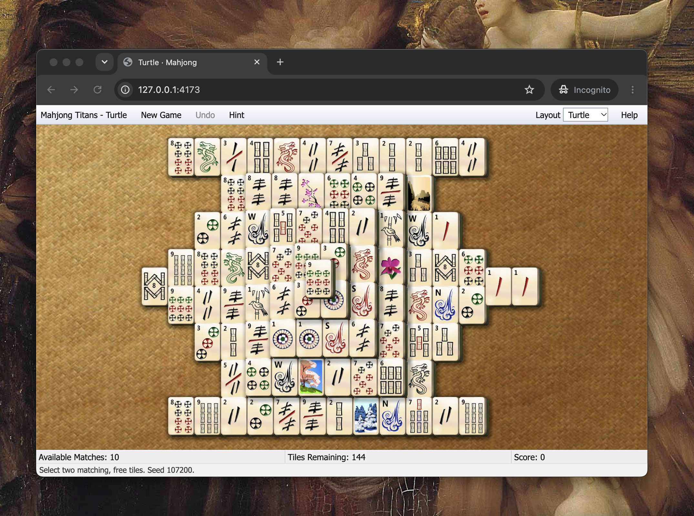

# The AI Clean Room: A Thought Experiment in Software Reverse Engineering

## A Game I Couldn't Give Up

I have a confession to make. For nearly twenty years, I've been playing the same computer game.

It's called *Mahjong Titans*, and it originally shipped with Microsoft Windows Vista. It's a simple solitaire game played with Mahjong tiles. There's nothing particularly revolutionary about it. No elaborate graphics, no complex storylines, no multiplayer competitions. Just a quiet, enjoyable game that I've returned to countless times over the years.

For me, it's almost meditative. I often play while listening to music, and there's something relaxing about the familiar patterns and simple decisions. It's one of those small pleasures that I never really thought much about.

Unfortunately, Microsoft stopped including Mahjong Titans with Windows, and the original game is no longer commercially available in any practical form that I've been able to find. So to keep up my habit, I've gone to increasingly ridiculous lengths to keep playing.

At one point, my solution involved running Windows 11, installing virtualization software, creating a Windows 7 virtual machine, and launching that virtual machine whenever I wanted to play Mahjong Titans.

Think about that for a moment. I purchased a special machine - running an entire operating system inside another operating system - just to play a simple game from the Vista era.

I had searched for a way to purchase the original game, but couldn't find one. I wasn't trying to avoid paying for software. I would have happily purchased it again. All I wanted to do was to keep playing my game.

## An Unexpected Experiment

I've also been spending a considerable amount of time exploring artificial intelligence, particularly the new generation of large language models and AI-assisted software development tools. I'd read about people using these tools to analyze existing software, understand how it worked, and even reconstruct programs from their compiled executables.

That got me thinking: Could I use AI to recreate Mahjong Titans? I decided to find out. Using OpenAI's Codex, I provided the necessary files from the original game and asked it to help me understand and reconstruct the software.

What followed was remarkable.

Codex obtained reverse-engineering tools, analyzed the compiled program, investigated its internal behavior, and gradually reconstructed the game's functionality. It then implemented a new version that ran directly in a web browser. No Windows 7. No virtual machine. No special operating system requirements. Just open a browser and play.

This wasn't simply an exercise in making something that looked like Mahjong Titans. The AI examined the underlying logic: how tiles were arranged, how moves were validated, how matching worked, and how the game behaved.

And the result was astonishingly faithful to the original.

The entire exercise took a couple of days. But here's the part that really surprised me: The primary limitation wasn't the difficulty of the engineering work. It was the number of AI tokens available under my subscription. If I had been willing to spend a bit more money, the same project might have been completed in a single day.

Now, I don't want to overstate what happened. Mahjong Titans is a relatively simple game compared with modern commercial software. And I haven't established that every aspect of the reimplementation is identical to the original.

But the experience was still extraordinary; a task that would previously have required specialized reverse-engineering knowledge, substantial programming effort, and probably a great deal of patience had become something I could accomplish by working with an AI system over a couple of days.

I had solved my problem. But I had also stumbled onto a much bigger question.

## An Evening on the Porch

A little while later, I found myself sitting on the porch, thinking about what I'd just witnessed.

I hadn't undertaken this project to make money. I had no intention of distributing the resulting software, competing with Microsoft, or turning it into a commercial product. I simply wanted to play an old game.

But what struck me was how accessible the entire process had become. I'd provided a compiled executable to an AI system, and that system had helped me recover enough information about the original software to build a remarkably faithful replacement.

What would have happened if the program had been more complex? What if it had been a discontinued productivity application? An old accounting package? A piece of specialized software whose original publisher had disappeared? And what if I hadn't allowed the same AI system to perform both the analysis and the implementation?

That last question led me to an interesting historical parallel.

## The Clean Room: An Old Idea Meets New Technology

In the early days of the personal computer, companies such as Compaq and Phoenix Technologies played important roles in establishing the market for IBM PC-compatible computers. One of the major challenges was reproducing the functionality of IBM's BIOS without copying IBM's copyrighted code. The solution involved a technique known as **clean-room reverse engineering**, in which one group of engineers studies an existing program and documents its behavior, while a separate group uses that documentation to create an independent implementation.

These efforts required significant resources. Engineers needed specialized knowledge, substantial time, and considerable financial investment to analyze the original software and reproduce its behavior. I've written a small companion article about that fascinating chapter of computing history, and you can find it [here](./reference_materials/ibm_compaq_clean_room_clone.md), so I won't repeat the details.

What interested me, sitting on my porch, was how much of that work might now be performed by AI. The clean-room concept itself hasn't changed, but the tools available to carry it out certainly have. If an AI system can analyze a compiled program and produce a detailed description of its functionality, and another AI system can independently implement that description, perhaps we could accomplish something similar to those historical efforts at a fraction of the cost.

## The Two-AI Thought Experiment

Imagine that we start with an existing commercial software application. It could be an old game, a discontinued business application, or even something still being sold today. We obtain a copy of the executable and provide it to an AI system, which we'll call **AI System A**. Its job is to reverse engineer the software, using whatever tools are necessary to understand how it works. It might disassemble machine instructions, examine data structures, run experiments, or observe the application's behavior under different conditions.

However, we give System A a very specific assignment: produce a detailed functional specification, and nothing more. We don't ask it to write a replacement application. Instead, we want it to document the software's behavior thoroughly enough that someone who has never seen the original could build a compatible program. This might include descriptions of inputs and outputs, algorithms, data formats, user interactions, and any other information necessary to reproduce the functionality.

Once the specification is complete, we take that document and shut down the first process. We then approach an entirely different AI provider. (Perhaps Anthropic if the first system was OpenAI, although the particular companies aren't important.) We give this second system, **AI System B**, only the functional specification. It receives none of the original executable files, none of the disassembled code, and none of the private analysis performed by System A. Its assignment is simply to write a new application that conforms to the specification.

The resulting software might use an entirely different programming language, architecture, or operating system. Internally, it might look nothing like the original application, yet still reproduce its behavior closely enough to be functionally equivalent. In principle, this would resemble the traditional clean-room approach, except that the two groups of human engineers have been replaced by two independent AI systems.

What makes this interesting to me isn't necessarily the technical achievement, although that alone would be impressive. Instead, it's the possibility that the economics of reverse engineering could change dramatically. Historically, reproducing a complex software application might have required months of work by experienced engineers. Could AI reduce that effort to days, or even hours? Could something that once required millions of dollars be accomplished for hundreds, or perhaps even tens, of dollars?

I don't know the answer, and I certainly wouldn't claim that every application could be reconstructed so easily. Some software depends on complex external services, undocumented hardware, enormous datasets, or behaviors that are difficult to discover through static analysis alone. Producing a sufficiently accurate specification might require substantial testing and human supervision. Nevertheless, my experience with Mahjong Titans suggests that at least some of the traditional barriers have already fallen considerably.

## Is It Really a Clean Room?

At this point, it's probably time to state the obvious: I'm not a lawyer. This is
NOT legal advice, and I have no idea what would happen if you did this commercially.
With that said, let's explore the topic a bit more.

For starters, there's an important distinction between my Mahjong Titans project and the hypothetical process I've just described. In my experiment, the same AI-assisted workflow performed both the reverse engineering and the reimplementation. There was no separation between the two activities, and I never intended there to be one. My objective was simply to recreate a game for my personal use, not to demonstrate a legally defensible clean-room process.

The two-AI approach is an extension of that experience, and it raises some questions that I don't know how to answer. Would using two separate AI systems genuinely establish the independence required for clean-room engineering? Would it matter that they were operated by different companies, or would a court be more interested in the information exchanged between them? And how would we determine whether the specification contained only functional descriptions rather than protected elements of the original implementation?

There's also the question of what the AI systems may already know. Unlike the human engineers involved in traditional clean-room projects, modern language models are trained on enormous collections of information. It's conceivable that an AI system tasked with writing a replacement application might already have encountered information about the original software during training. Whether that would matter legally is something I'd be interested in hearing from people with expertise in intellectual property law.

To be sure, there are many additional open questions. I find them fascinating because clean-room engineering is a concept developed around human capabilities and human limitations. AI introduces new complications, but it may also offer new ways to document and enforce that separation. For example, it might be possible to preserve complete records of the information provided to each system, the instructions they received, and the artifacts they produced. Whether those records would be persuasive evidence in a legal dispute is another matter entirely.

The point isn't that using two AI providers magically creates a legally acceptable clean room. It's that the technology may make this kind of separation inexpensive and repeatable enough that the legal questions become increasingly relevant.

## Beyond the Legal Questions

The legal implications are interesting, but I think the ethical and economic questions may be just as important. Consider the problem of software preservation, which is what started this entire journey for me. There are countless games and applications that are no longer commercially available, either because their publishers abandoned them, their original hardware became obsolete, or the companies responsible for maintaining them simply disappeared.

Should we think differently about recreating software that can no longer be purchased? It seems reasonable to ask whether preserving an abandoned application is fundamentally different from reproducing one that is still generating revenue for its creator.

My Mahjong Titans experience illustrates this distinction. I wasn't trying to avoid paying Microsoft for a game. I was trying to continue enjoying something that I had legally purchased, and which effectively disappeared from the marketplace. Had Microsoft offered a modern version of the original game, I would have gladly purchased it. Instead, I found myself maintaining an entire virtual machine just to keep it running.

Now consider a very different situation. Suppose an AI-based clean-room process could reproduce the functionality of a modern commercial application for a tiny fraction of its original development cost. Would that represent healthy competition, allowing new developers to offer compatible alternatives? Or would it undermine the economic incentives that encouraged the original developers to invest their time and money in creating the software?

I suspect the answer would depend heavily on the circumstances. Reimplementing a discontinued game for personal enjoyment is quite different from reproducing a successful commercial application and selling a competing product. But where should the boundaries be drawn, and who should draw them? These are questions that involve not only copyright law, but also our broader expectations about creativity, ownership, competition, and technological progress.

There's another economic dimension that I find particularly interesting. Historically, the difficulty of reverse engineering created a practical barrier to reproducing complex software, regardless of whether doing so was legally permissible. Even if a company had every right to develop a compatible alternative, the cost of understanding and recreating the original program could make the project economically unattractive.

Artificial intelligence may be changing that calculation. If the cost of understanding existing software falls dramatically, entirely new categories of projects may become feasible. Developers might be able to preserve abandoned applications, create compatible replacements for obsolete systems, or offer alternatives to software whose original vendors no longer provide support. At the same time, the same capabilities could be used to challenge companies that continue to invest heavily in original software development.

In fact, we're already beginning to see experiments along these lines. In late 2026, a developer named Brandon Thomas launched a collection of open-source projects intended to recreate major applications from Adobe's Creative Cloud and Microsoft's Office suite, using AI-assisted development. The effort, known as ArtCraft, includes projects targeting Photoshop, Illustrator, Premiere Pro, Word, Excel, and PowerPoint, among others. These are still early implementations, and their authors' descriptions of them as clean-room reimplementations shouldn't be confused with a legal determination. Nevertheless, the fact that someone is attempting to recreate such substantial commercial applications with AI assistance illustrates just how quickly this field is evolving.

Will this result in more innovation, more competition, and better preservation of our computing history? Or will it reduce the incentives to create new software in the first place? Perhaps both outcomes could occur simultaneously, depending on the market and the circumstances.

I don't think there's an obvious answer, and that's part of what makes this subject worth discussing.

## Back on the Porch

When I began this project, I wasn't thinking about intellectual property law, the history of the IBM PC, or the economics of software development. I was simply trying to find a better way to play Mahjong Titans, a game that had been part of my life for nearly twenty years. A couple of days later, I had a browser-based version that was remarkably faithful to the original, and I no longer needed to maintain an obsolete operating system just to enjoy it.

But the experience left me thinking about something much larger than the game itself. A kind of engineering work that I had always considered difficult, expensive, and highly specialized had suddenly become accessible to me. And once I began considering how the same technology might be combined with traditional clean-room techniques, I realized that the implications could extend far beyond software preservation.

I don't know whether a two-AI clean-room process would survive legal scrutiny, or how effectively it would work with more complex applications. I also don't know whether widespread adoption of such techniques would ultimately benefit software developers, consumers, or society as a whole. There are reasonable arguments on multiple sides, and I think it would be premature to draw firm conclusions.

I'm not advocating that people use AI to reproduce commercial software, nor am I suggesting that the practice should be prohibited. I'm simply interested in what happens when a technological barrier that has existed for decades begins to disappear. History suggests that when the cost of doing something changes dramatically, the legal, economic, and ethical questions surrounding it often become much more urgent.

So that's where I find myself, still thinking about that evening on the porch. I started with a simple desire to keep playing an old computer game, and ended up wondering whether artificial intelligence might fundamentally change the way we think about software ownership and compatibility.

If AI makes it inexpensive to reproduce the functionality of existing software, how should we balance the rights of its original creators against the benefits of preservation, competition, and technological progress?

I don't have an answer. But I'd certainly be interested in hearing what others think.

## Appendix

[Did I use AI to help me write this?](./images/yes.png)