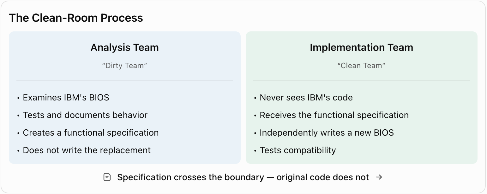
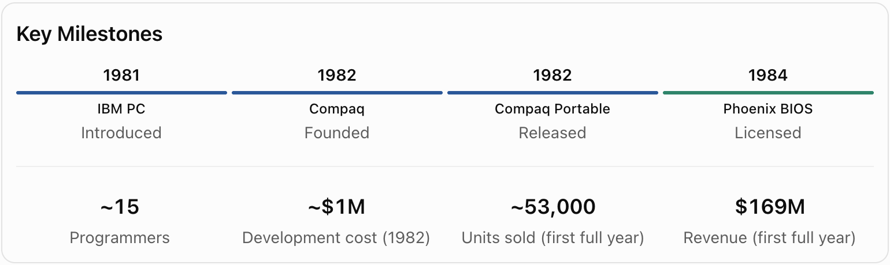

# The Million-Dollar Clone

> How Compaq challenged IBM, unlocked the personal computer industry, and demonstrated the power of clean-room reverse engineering.

**NOTE:** This isn't really an artificial dream, but it is relevant to one, so I'm including it for your consideration.
Enjoy!

In 1981, IBM entered the personal computer market with a machine that brought unprecedented credibility to an emerging industry. The IBM PC was built largely from commercially available components—an Intel processor, a Microsoft operating system, and standard memory and peripheral chips—making it relatively easy for competitors to imitate the hardware. But there was one critical obstacle: the Basic Input/Output System, or BIOS. This small piece of firmware provided the essential connection between software and hardware, and its precise behavior was crucial to running IBM PC applications. IBM owned the copyright to its BIOS implementation, meaning that competitors could build similar machines but could not simply copy the code that made them compatible. In an otherwise remarkably open architecture, the BIOS represented a formidable barrier to competition.

In 1982, three former Texas Instruments managers—Rod Canion, Jim Harris, and Bill Murto—founded Compaq with an ambitious objective: build a portable computer capable of running the same software as an IBM PC. Their solution was clean-room reverse engineering, an ingenious methodology that separated the analysis of existing software from the development of its replacement. One team of engineers studied IBM's BIOS, examining its behavior and producing a detailed functional specification without passing along IBM's code. A second team, never exposed to the original implementation, independently wrote a replacement BIOS using only that specification. This separation helped demonstrate that the new code was independently developed rather than copied, although clean-room procedures were not an automatic guarantee against every possible intellectual property claim.

The undertaking was far more difficult than its simple description suggests. According to accounts featured in Robert X. Cringely's documentary Triumph of the Nerds, Compaq's effort involved approximately fifteen senior programmers, consumed several months, and cost roughly one million dollars—in 1982 money. Although the BIOS was tiny by modern standards, reproducing its precise behavior, including undocumented quirks that existing applications might depend upon, was extraordinarily challenging. Yet Compaq succeeded. In November 1982, it announced the Compaq Portable, a roughly 28-pound computer that could run IBM PC software. The market response was remarkable: during its first full year, Compaq reportedly sold approximately 53,000 computers, generating $169 million in revenue. The million-dollar engineering gamble had paid off spectacularly.

Compaq demonstrated that the obstacle could be overcome, but another company would soon make the breakthrough accessible to the entire industry. In 1984, Phoenix Technologies introduced its own independently developed IBM-compatible BIOS, offering it for licensing to other computer manufacturers. Instead of financing elaborate reverse-engineering projects, manufacturers could purchase compatible firmware, assemble computers from standard components, and concentrate on design, production, and sales. This helped unleash an expanding ecosystem of IBM-compatible machines, increasing competition and contributing to falling prices. IBM had helped establish the personal computer as an industry standard, yet it increasingly lost control of the market built around that standard. Microsoft, Intel, and numerous independent manufacturers became central players in an ecosystem that no longer depended exclusively on IBM hardware.

The significance of this achievement extended far beyond a particular computer or a few thousand lines of firmware. Clean-room reverse engineering demonstrated that reproducing what software does is fundamentally different from copying how its original authors implemented it. Two programs can exhibit essentially identical behavior while being independently developed, creating opportunities for compatibility, competition, and innovation. But this freedom came at a considerable price. The process demanded specialized expertise, rigorous documentation, organizational separation, extensive testing, and substantial financial resources. For decades, those requirements imposed a practical limit on reverse engineering: even when reproducing an application's functionality was technically possible, the cost could easily exceed the commercial value of the result. Complexity itself became a powerful competitive barrier.

---

> Historical references: Robert X. Cringely, Triumph of the Nerds (1996); Carliss Y. Baldwin, Harvard Business School research on the IBM PC ecosystem; contemporary accounts of Compaq and Phoenix Technologies.

[Did I use AI to help me write this?](../images/yes.png)